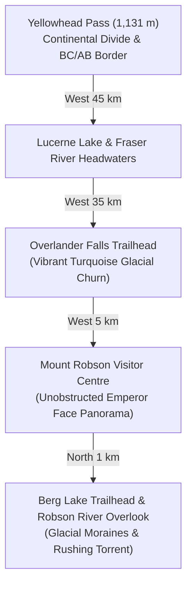

# Heart of the Rockies & Mount Robson: Secret Gems & Curated Wonders Guide

---

## 1. The Crown Jewel: Mount Robson Provincial Park (British Columbia)

Mount Robson is the undisputed monarch of the Canadian Rockies. Rising to **3,954 meters (12,972 feet)**, it is the highest peak in the Canadian Rocky Mountain chain, towering nearly 3,000 vertical meters directly above the Yellowhead Highway (BC-16).

### Essential Mount Robson Stops:
1. **Mount Robson Visitor Centre Deck**: Located directly on BC-16 at the base of the mountain. Step onto the elevated wooden viewing deck for an unobstructed sightline up the colossal **Emperor Face**, one of the most famous rock and ice walls in mountaineering history.
2. **Berg Lake Trailhead & Robson River**: A short ride up the access road brings you to the bridge over the roaring, milky-turquoise Robson River. Walk the first 1.5 km of the trail for sweeping viewpoints of the glacier moraines.
3. **Overlander Falls**: Just 5 km east of the visitor centre, a gentle 15-minute forested walk leads to a thunderous turquoise waterfall cascading through a narrow canyon of quartzite and limestone.
4. **Yellowhead Pass Continental Divide**: Straddling the BC and Alberta boundary at 1,131 m (3,711 ft), where waters flowing east head to the Arctic Ocean via the Mackenzie River, and waters flowing west head to the Pacific Ocean via the Fraser River.

---

## 2. The #1 Motorcycle Road on Earth: The Icefields Parkway (Alberta Hwy 93N)

Stretching 232 km (144 miles) between Lake Louise and Jasper, the Icefields Parkway traverses the Continental Divide through over 100 visible glaciers, turquoise alpine lakes, and sheer limestone pinnacles.

### Must-Stop Waypoints Along the Parkway:
1. **Bow Lake & Num-Ti-Jah Lodge (Km 37)**: A massive glacier-fed lake sitting under the hanging ice of the Bow Glacier. The historic red-roofed log lodge built by legendary mountain guide Jimmy Simpson is a timeless motorcycle photo stop.
2. **Peyto Lake from Bow Summit (Km 40)**: At 2,088 meters (6,850 ft), Bow Summit is the highest pass on the Icefields Parkway. A 10-minute paved trail leads to the iconic overlook of Peyto Lake, famous for its bright turquoise color shaped like the profile of a wolf's head.
3. **The Weeping Wall (Km 106)**: A 100-meter vertical limestone cliff where meltwater from the Cirrus Mountain snowfields cascades in dozens of delicate white ribbon waterfalls directly beside the highway.
4. **Columbia Icefield Discovery Centre & Athabasca Glacier (Km 127)**: The hydrographic apex of North America. Walk right to the toe of the Athabasca Glacier, where glacial melt eventually drains to the Atlantic, Pacific, and Arctic oceans.
5. **Sunwapta Falls (Km 177)**: Fed directly by the Athabasca Glacier, the rushing river bifurcates around a forested island before plunging into a deep limestone canyon.
6. **Athabasca Falls (Km 200)**: Powerful churning gorge carved into hard quartzite rock. Boardwalk paths take you directly over mist-filled potholes and churning whirlpools.

---

## 3. Banff & Yoho National Park Alpine Masterpieces

1. **Bow Valley Parkway (Hwy 1A)**: Parallel to the high-speed Trans-Canada, this winding, lower-speed forested route offers quiet curves and spectacular unobstructed vistas of **Castle Mountain** (2,766 m).
2. **Lake Louise**: Framed by the hanging ice of Mount Victoria and the Fairmont Chateau Lake Louise. Best viewed in early morning before tourist tour buses arrive.
3. **Spiral Tunnels Overlook (Yoho NP)**: High in the Kicking Horse Pass, watch long CP freight trains loop through the mountains inside Mount Ogden and Cathedral Mountain, crossing over themselves to conquer the steep gradient.
4. **Emerald Lake & Natural Bridge**: Vibrant jade-green waters nestled beneath the President Range, crossed by a wooden bridge leading to cozy lakeside log cabins.

---

## 4. Lake Superior & Northern Highway 11 Curated Icons

1. **Old Woman Bay (Lake Superior Provincial Park)**: 130-meter sheer red granite cliffs dropping directly into the crystalline waters of Lake Superior.
2. **Terry Fox Memorial & Lookout (Thunder Bay)**: Majestic 9-foot bronze statue of Terry Fox looking out over Thunder Bay and the famous Sleeping Giant peninsula.
3. **Kakabeka Falls (Niagara of the North)**: 40-meter vertical waterfall plunging into a gorge containing some of the oldest microfossils on earth (1.6 billion years old).
4. **Lake of the Woods Waterfront (Kenora)**: A labyrinth of 14,500 islands and 65,000 miles of shoreline.
5. **Canadian Polar Bear Habitat (Cochrane)**: The only sanctuary in the world dedicated exclusively to polar bear rescue and research, featuring 5-acre subarctic lake habitats.
6. **Temagami Fire Tower on Caribou Mountain**: Historic 100-foot fire lookout tower perched high on white pine bluffs with 40-km panoramic views across old-growth forests.
